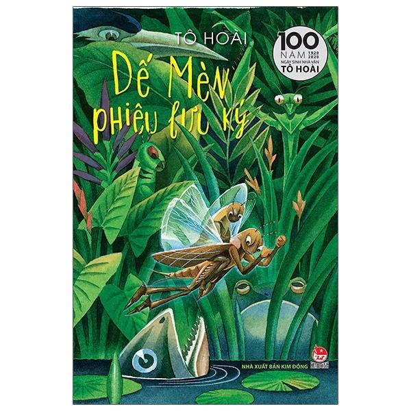

AI Usage Log

1\. Công cụ AI

- Google Gemini: Hỗ trợ phân tích website FAHASA, đề xuất thiết kế và xây dựng giao diện HTML/CSS ban đầu trong Buổi 1.
- ChatGPT: Hỗ trợ phân tích mã nguồn hiện có, giải thích HTML5/CSS3, hướng dẫn điều chỉnh giao diện, kiểm tra lỗi và rà soát báo cáo trong Buổi 2.


2\. Mục đích sử dụng


2. Mục đích sử dụng

Trong Buổi 1, Gemini được sử dụng để phân tích các khu vực của website FAHASA, đề xuất cải tiến thẻ sản phẩm và hỗ trợ tạo giao diện bằng HTML5/CSS3.

Trong Buổi 2, ChatGPT được sử dụng để rà soát mã nguồn đã có, hỗ trợ thực hành CSS Selector, Box Model, Flexbox, CSS Grid, Hover/Focus và kiểm tra giao diện responsive. Các đề xuất được đối chiếu với mã nguồn và kiểm tra trực tiếp trên trình duyệt trước khi hoàn thiện.


3\. Prompt đã sử dụng

Prompt 1 – Phân tích website


Yêu cầu Gemini phân tích các khu vực chính của FAHASA, gồm chức năng, thành phần giao diện, điểm thuận tiện, vấn đề có thể phát sinh và đề xuất cải tiến:


"

Bạn là chuyên gia phân tích nghiệp vụ và thiết kế trải nghiệm người dùng


cho website thương mại điện tử.


Tôi đang khảo sát website: \[https://www.fahasa.com/](https://www.fahasa.com/)


Hãy giúp tôi lập bảng phân tích các khu vực:


1\. Trang chủ.


2\\. Danh mục sản phẩm.


3\\. Chi tiết sản phẩm.


4\\. Tìm kiếm.


5\\. Giỏ hàng.


Với mỗi khu vực, hãy nêu:


\- Mục đích của chức năng.

\- Thành phần giao diện cần có.

\- Điểm thuận tiện đối với khách hàng.

\- Một vấn đề có thể phát sinh.

\- Một đề xuất cải tiến.


Không khẳng định những tính năng chưa được kiểm chứng.


Phân biệt rõ nhận xét dựa trên quan sát và đề xuất của AI.
"


Prompt 2 – Đề xuất phương án thiết kế


Yêu cầu Gemini đề xuất bố cục, thành phần HTML, cách tổ chức CSS, hiển thị responsive và các điểm cần kiểm tra cho thẻ sản phẩm:


"

Tôi đang thực hiện bài tập phát triển giao diện website thương mại điện tử bằng HTML5 và CSS3.


Website: FAHASA (\[https://www.fahasa.com](https://www.fahasa.com))


\*\*Tôi muốn cải tiến khu vực:\*\* Thẻ sản phẩm (Product Card) trong danh sách sản phẩm.


\*\*Đối tượng sử dụng:\*\* Khách hàng mua sắm sách trực tuyến tại Việt Nam.


Hãy đề xuất:


1\\. Bố cục giao diện.


2\\. Các thành phần HTML cần sử dụng.


3\\. Cách tổ chức CSS.


4\\. Cách hiển thị trên máy tính và điện thoại.


5\\. Những điểm cần kiểm tra về khả năng sử dụng.


Trước tiên, hãy giải thích phương án thiết kế.


Chưa tạo toàn bộ mã nguồn cho đến khi tôi yêu cầu.


Trước tiên, hãy giải thích phương án thiết kế và lý do lựa chọn. Chưa tạo toàn bộ mã nguồn cho đến khi tôi yêu cầu.
"


Prompt 3 – Tạo mã nguồn HTML/CSS


Yêu cầu Gemini tạo giao diện mẫu có tối thiểu bốn sản phẩm, CSS riêng và hướng dẫn chạy thử:


Dựa trên phương án đã thống nhất, hãy tạo một trang giao diện


thương mại điện tử bằng HTML5 và CSS3.


Yêu cầu:


\\- Giao diện có tiêu đề và khu vực sản phẩm.


\\- Có tối thiểu 4 sản phẩm mẫu.


\\- Mỗi sản phẩm có hình ảnh, tên, giá và nút thao tác.


\\- Bố cục phù hợp với màn hình máy tính và điện thoại.


\\- Mã HTML có cấu trúc rõ ràng.


\\- CSS được tách thành file riêng.


\\- Không sử dụng backend hoặc cơ sở dữ liệu.


\\- Không đưa thư viện hoặc thành phần không cần thiết vào dự án.


Giải thích cách chạy trang web và những phần tôi cần kiểm tra.


Prompt 4 – Điều chỉnh giao diện sau khi kiểm tra


Nêu bốn vấn đề phát hiện từ bản chạy thử và yêu cầu Gemini sửa lại mã nguồn, giữ các phần đã hoạt động tốt:

"

Tôi nhận thấy một số điểm cần chỉnh sửa:


1\. Một số tên sách dài vẫn bị cắt bằng dấu ba chấm, đặc biệt là Cây Cam Ngọt Của Tôi và Đắc Nhân Tâm. Tôi muốn tên sách được hiển thị đầy đủ, có thể tự xuống dòng nhưng vẫn giữ phần giá và nút mua hàng thẳng hàng giữa các thẻ.

2\. Hình ảnh hiện tại chỉ là các khung màu có tên sách. Tôi muốn thay bằng ảnh bìa sách thực tế. Hãy hướng dẫn cách lưu ảnh vào thư mục images và điều chỉnh đường dẫn trong HTML để có thể sử dụng ảnh từ máy tính.

3\. Nút yêu thích hình trái tim hiện chưa có chức năng xử lý. Tôi muốn bỏ nút này để giao diện đơn giản hơn.

4\. Trên điện thoại, tôi muốn tăng chiều cao nút "Thêm vào giỏ" lên tối thiểu 44px để dễ thao tác hơn. Vẫn giữ bố cục hai cột như hiện tại.


Hãy chỉnh sửa dựa trên mã nguồn đã tạo trước đó, giữ lại những phần đang hoạt động tốt. 


Sau khi chỉnh sửa, hãy cung cấp mã HTML và CSS hoàn chỉnh, đồng thời giải thích ngắn gọn những phần đã thay đổi để tôi có thể kiểm tra lại trên trình duyệt.
"


4\. Kết quả AI đề xuất


Gemini tạo trang sản phẩm mẫu với bốn thẻ sách, gồm hình ảnh, tên sách, tác giả, giá gốc, giá bán và nút "Thêm vào giỏ". HTML5 được dùng để tổ chức nội dung; CSS Grid bố trí danh sách sản phẩm, Flexbox căn chỉnh các thành phần và Media Queries hỗ trợ hiển thị theo kích thước màn hình.


5\. Kiểm tra và điều chỉnh


Mã nguồn ban đầu được đưa vào Visual Studio và chạy thử bằng Google Chrome. Khi kiểm tra trên máy tính và mô phỏng iPhone SE (375 × 667 px) bằng Chrome DevTools, bố cục đã chuyển từ bốn cột sang hai cột đúng theo CSS. Tuy nhiên, một số tên sách dài vẫn bị giới hạn hai dòng; ảnh sản phẩm chỉ là hình minh họa; nút yêu thích chưa có chức năng xử lý và vùng nhấn nút giỏ hàng trên điện thoại còn nhỏ.


Các điều chỉnh Gemini hỗ trợ thực hiện:

\- Bỏ giới hạn hai dòng trong .product-title để hiển thị đầy đủ tên sách.

\- Chỉnh thuộc tính src trong HTML để sử dụng ảnh bìa sách lưu ở images/.

\- Xóa nút yêu thích và các quy tắc CSS liên quan.

\- Tăng min-height của .btn-cart lên 44px trong CSS dành cho điện thoại.


Sau khi cập nhật mã, bốn ảnh sách được lưu và đổi tên cho khớp đường dẫn HTML. Giao diện trên Chrome máy tính đã hiển thị ảnh và tên sách đầy đủ. Bản sau chỉnh sửa vẫn cần được kiểm tra lại ở kích thước điện thoại trước khi kết luận hoàn tất bước kiểm thử responsive.


6\. Các thành phần mã nguồn có thể giải thích


\- header, main, section, article: Phân chia bố cục và nội dung trang web trong HTML5.

\-  và thuộc tính src: Hiển thị hình ảnh sản phẩm từ thư mục images/.

\- .product-grid với CSS Grid: Tổ chức danh sách sản phẩm thành các cột có kích thước đồng đều. Media Queries điều chỉnh số cột theo chiều rộng màn hình. Khi kiểm tra Buổi 2 tại 390px, 768px và 1366px, giao diện lần lượt hiển thị 2, 2 và 4 cột.


\- .product-card, .card-body và .card-footer với Flexbox: Bố trí nội dung theo chiều dọc và giữ phần giá, nút mua hàng ở cuối thẻ.

\- .product-title và word-break: Cho phép tên sách dài xuống dòng mà không bị cắt ở hai dòng.

\- .card-footer với margin-top: auto: Đẩy phần giá và nút mua hàng xuống phần cuối của thẻ sản phẩm.

\- Media Queries và .btn-cart với min-height: 44px: Điều chỉnh bố cục, tăng vùng thao tác trên màn hình điện thoại.

Buổi 2 – Prompt 1: Phân tích mã nguồn hiện tại
 Prompt đã sử dụng
1. Prompt 1 – Phân tích mã nguồn hiện tại 
Tôi đang làm bài tập cá nhân môn Phát triển ứng dụng thương mại điện tử.
Trong Buổi 1, tôi đã khảo sát một website TMĐT và tạo
một giao diện cải tiến bằng HTML/CSS.
Đây là mã HTML hiện tại:
https://github.com/nvt080906/ecommerce-ui-improvement/blob/main/index.html
Đây là mã CSS hiện tại nếu có:
https://github.com/nvt080906/ecommerce-ui-improvement/blob/main/styles.css
Hãy giúp tôi:
Xác định những thành phần HTML đã có.
Chỉ ra các thành phần HTML còn thiếu hoặc chưa hợp lý.
Nêu ba vấn đề về cấu trúc HTML hoặc trình bày.
Đề xuất cách cải thiện bằng kiến thức HTML5 và CSS3 cơ bản.
Giải thích thứ tự nên thực hiện các cải tiến.
Chưa viết lại toàn bộ mã nguồn.
Không tạo website mới.
Hãy giúp tôi hiểu mã hiện tại trước khi sửa.

Kết quả phân tích của AI

AI xác định mã nguồn Buổi 1 đã sử dụng các phần tử HTML5 như header, main, section và article. Giao diện cũng đã có CSS Grid, Flexbox, Box Model và hiệu ứng hover.

Ba vấn đề được đề xuất cải thiện gồm:
- Các liên kết sản phẩm chưa có trang đích thực tế.
- Khu vực danh sách sản phẩm chưa sử dụng aria-labelledby để liên kết với tiêu đề.
- Chưa định nghĩa trạng thái focus-visible riêng cho liên kết và nút.

Kiểm tra và định hướng điều chỉnh

Đối chiếu kết quả với mã nguồn hiện tại, em giữ nguyên các thành phần HTML/CSS đã sử dụng phù hợp. Các đề xuất cải thiện được giới hạn trong khu vực thẻ sản phẩm, không xây dựng lại website hoặc bổ sung chức năng ngoài phạm vi bài tập.

Kết quả rà soát được trình bày trong README.md, mục "Bước 1. Rà soát giao diện Buổi 1".


Prompt 2 – Kiểm tra cấu trúc HTML5

Prompt đã sử dụng

Tôi đang học HTML5 và muốn cải thiện cấu trúc HTML của bài tập Buổi 1.

Đây là mã HTML hiện tại:
https://github.com/nvt080906/ecommerce-ui-improvement/blob/main/index.html

Hãy hướng dẫn tôi:
1. Xác định các phần tử HTML đang được sử dụng.
2. Kiểm tra cách sử dụng header, nav, main, section,
article và footer nếu có.
3. Kiểm tra thứ bậc tiêu đề h1, h2, h3.
4. Kiểm tra cách sử dụng img, alt và a.
5. Phát hiện các thẻ chưa đóng hoặc lồng nhau chưa hợp lý.
6. Đề xuất cách sửa phù hợp với nội dung hiện tại.

Hãy phân biệt lỗi cần sửa và đề xuất cải thiện.
Không thêm phần tử HTML chỉ để làm mã nguồn dài hơn.
Không viết lại toàn bộ website.
Giải thích lý do của từng thay đổi.

Kết quả phân tích của AI

1. Các phần tử HTML đang sử dụng

Mã nguồn đã sử dụng `header`, `main`, `section`, `article`, các thẻ tiêu đề `h1–h3`, cùng các phần tử `img`, `a`, `p`, `button`, `ins` và `del` để trình bày thông tin sản phẩm.

2. Kiểm tra cấu trúc HTML5

Các phần tử `header`, `main`, `section` và `article` được sử dụng phù hợp. Trong đó, `header` chứa thông tin đầu trang, `main` bao bọc nội dung chính, `section` phân chia khu vực sách bán chạy và `article` đại diện cho từng sản phẩm. Các thẻ `nav` và `footer` chưa xuất hiện nhưng không bắt buộc bổ sung khi chưa có nội dung tương ứng.

3. Kiểm tra thứ bậc tiêu đề

Cấu trúc tiêu đề được phân cấp hợp lý: `h1` thể hiện tiêu đề trang, `h2` thể hiện tiêu đề khu vực và `h3` thể hiện tên từng sản phẩm.

4. Kiểm tra hình ảnh và liên kết

Bốn hình ảnh sản phẩm đều có thuộc tính `alt` mô tả tên sách. Các liên kết `a` được sử dụng cho hình ảnh và tên sản phẩm. Tuy nhiên, các liên kết hiện sử dụng `href="#"`, chưa có trang chi tiết thực tế.

5. Kiểm tra lỗi cấu trúc

Qua rà soát mã nguồn, chưa phát hiện thẻ HTML thiếu đóng hoặc lồng nhau không hợp lý một cách rõ ràng. Thuộc tính `tabindex="-1"` trên liên kết hình ảnh không mặc nhiên là lỗi vì tên sản phẩm đã có liên kết riêng để điều hướng bằng bàn phím.

6. Đề xuất cải thiện

AI đề xuất bổ sung `aria-labelledby` cho khu vực `section` và `id` tương ứng cho tiêu đề nhằm tăng tính rõ ràng về ngữ nghĩa. Đồng thời, cần rà soát các liên kết chưa có trang đích nhưng không xây dựng thêm trang hoặc chức năng ngoài phạm vi bài tập.

Kiểm tra và điều chỉnh của sinh viên

Sau khi đối chiếu kết quả phân tích với mã nguồn, em giữ nguyên các phần tử HTML đã sử dụng phù hợp, đồng thời lựa chọn bổ sung `id` và `aria-labelledby` để liên kết khu vực danh sách sản phẩm với tiêu đề.

Các liên kết chưa có trang đích được ghi nhận là giới hạn của website demo. Việc cải thiện chỉ tập trung vào cấu trúc HTML, không thay đổi bố cục và không phát triển thêm chức năng mới.

Prompt 3 – Tạo CSS cơ bản

Prompt đã sử dụng

Tôi có website HTML5 từ bài tập Buổi 1.

Cấu trúc thư mục:

```text
ecommerce-ui-improvement-buoi2/
├── evidence/
│   └── 01-before.png
├── images/
│   ├── cay-cam-ngot-cua-toi.jpg
│   ├── dac-nhan-tam.jpg
│   ├── de-men-phieu-luu-ky.jpg
│   └── nha-gia-kim.jpg
├── AI_USAGE.md
├── index.html
├── README.md
└── styles.css
```

Đoạn HTML:

```html
<head>
    <meta charset="UTF-8">
    <meta name="viewport" content="width=device-width, initial-scale=1.0">
    <title>Giao diện Danh sách Sản phẩm FAHASA</title>
    <link rel="stylesheet" href="styles.css">
</head>
```

Khu vực danh sách sản phẩm trong `index.html` sử dụng `section.product-section`, `div.product-grid` và các `article.product-card`.

Mã HTML đầy đủ:
https://github.com/nvt080906/ecommerce-ui-improvement/blob/main/index.html

Hãy hướng dẫn tôi:
1. Tạo và liên kết file css/style.css.
2. Định dạng font chữ, màu chữ và màu nền.
3. Thiết lập margin và các quy tắc cơ bản cho body.
4. Đảm bảo hình ảnh không vượt quá chiều rộng phần tử chứa.
5. Kiểm tra đường dẫn CSS có chính xác không.

Chỉ tạo CSS cần thiết cho bài tập.
Không sử dụng Bootstrap hoặc Tailwind CSS.
Giải thích từng nhóm thuộc tính và hướng dẫn tôi cách kiểm tra bằng trình duyệt.


Kết quả phân tích của AI

1. Kiểm tra tệp CSS

Mã nguồn đã có tệp `styles.css` được liên kết với `index.html` thông qua đường dẫn tương đối `href="styles.css"`.

Mặc dù prompt đề cập đến `css/style.css`, việc tạo thêm tệp mới không cần thiết vì CSS hiện tại đã được tổ chức riêng và liên kết đúng.

2. Kiểm tra định dạng cơ bản

Tệp CSS đã khai báo font chữ, màu nền, màu chữ và khoảng cách dòng cho `body`. Các biến CSS trong `:root` được sử dụng để quản lý màu sắc và thuộc tính thiết kế chung.

3. Kiểm tra Box Model

Mã nguồn đã sử dụng `margin`, `padding` và `box-sizing: border-box` để kiểm soát khoảng cách, kích thước của các phần tử. Các thuộc tính này sẽ tiếp tục được thực hành ở Bước 4.

4. Kiểm tra hình ảnh

Hình ảnh sản phẩm sử dụng `width: 100%`, `height: 100%` và `object-fit: cover` trong khung ảnh có tỷ lệ xác định. Cần kiểm tra trực quan để bảo đảm hình ảnh không bị méo hoặc cắt mất nội dung quan trọng.

5. Kiểm tra đường dẫn CSS

Đường dẫn `styles.css` phù hợp với cấu trúc thư mục vì HTML và CSS nằm cùng cấp. Kết quả mở trang trên Chrome cho thấy các quy tắc CSS đã được áp dụng.

**Kiểm tra và điều chỉnh của sinh viên**

Sau khi đối chiếu kết quả AI với mã nguồn và giao diện thực tế, em giữ nguyên tệp `styles.css` thay vì tạo thêm `css/style.css`. Việc kiểm tra được thực hiện trên phiên bản website mở từ máy tính.

Kết quả xác nhận giao diện hiển thị đúng màu sắc, kiểu chữ và bố cục. Không phát hiện vấn đề về đường dẫn CSS trong bước kiểm tra này.


Prompt 4

Tôi muốn thực hành CSS selector và Box Model trên một thẻ sản phẩm trong website của
mình.

HTML hiện tại:

<article class="product-card">
    <div class="card-media">
        <span class="badge-discount">-10%</span>
        <a href="#" class="image-link" tabindex="-1">
            
        </a>
    </div>
    <div class="card-body">
        <h3 class="product-title">
            <a href="#">Dế Mèn Phiêu Lưu Ký (Tái Bản 2024)</a>
        </h3>
        <p class="product-author">Tô Hoài</p>
        <div class="card-footer">
            <div class="price-box">
                <ins class="current-price">45.000 đ</ins>
                <del class="old-price">50.000 đ</del>
            </div>
            <button type="button" class="btn-cart">
                <svg width="16" height="16" viewBox="0 0 24 24" fill="none" stroke="currentColor" stroke-width="2"><circle cx="9" cy="21" r="1"></circle><circle cx="20" cy="21" r="1"></circle><path d="M1 1h4l2.68 13.39a2 2 0 0 0 2 1.61h9.72a2 2 0 0 0 2-1.61L23 6H6"></path></svg>
                <span>Thêm vào giỏ</span>
            </button>
        </div>
    </div>
</article>

Hãy hướng dẫn tôi:
1. Sử dụng element selector và class selector.
2. Sử dụng descendant selector khi phù hợp.
3. Điều chỉnh margin, padding và border.
4. Sử dụng border-radius để bo góc.
5. Định dạng tên và giá sản phẩm.
6. Định dạng liên kết thành nút thao tác đơn giản.

Hãy giải thích sự khác nhau giữa margin và padding.
Giải thích tác dụng của box-sizing: border-box.
Chỉ đưa ra phần CSS cần thiết.
Không thay đổi nội dung hoặc tạo lại toàn bộ HTML.

Phản hồi và kết quả thực hiện Prompt 4

AI hướng dẫn sử dụng các loại CSS Selector và thuộc tính Box Model để định dạng thẻ sản phẩm.

Các selector được sử dụng gồm:
- Element selector: body, dùng để định dạng chung cho trang.
- Class selector: .product-card, .card-body, .product-title.
- Descendant selector: .product-title a, dùng để chọn liên kết bên trong tên sản phẩm.

Các thay đổi CSS được thực hiện:
- Tăng padding của .card-body từ 12px lên 24px.
- Tăng margin-bottom của .product-title từ 6px lên 14px.
- Điều chỉnh border thành 2px solid #b3bdca.
- Điều chỉnh border-radius thành 14px.
- Giữ nguyên định dạng tên, giá và nút thêm vào giỏ hàng hiện có.

Giải thích kiến thức:
- Margin tạo khoảng cách bên ngoài phần tử.
- Padding tạo khoảng cách giữa nội dung và đường viền.
- Border tạo đường viền bao quanh phần tử.
- Border-radius giúp bo tròn các góc.
- Box-sizing: border-box giúp padding và border được tính trong kích thước width và height đã thiết lập.

Kết quả:
Giao diện sau chỉnh sửa có đường viền rõ hơn, góc bo tròn hơn và khoảng cách bên trong thẻ sản phẩm lớn hơn.

Một số tên sách xuống dòng do padding tăng, nhưng bố cục bốn cột vẫn được giữ nguyên.

HTML không thay đổi. Các điều chỉnh được thực hiện trong styles.css.

Prompt 5 – Thực hành Flexbox

Tôi đang học CSS3 và muốn thực hành Flexbox trên một khu vực của website thương mại điện tử.

Đây là HTML hiện tại:

<button type="button" class="btn-cart">
    <svg width="16" height="16" viewBox="0 0 24 24" fill="none" stroke="currentColor" stroke-width="2"><circle cx="9" cy="21" r="1"></circle><circle cx="20" cy="21" r="1"></circle><path d="M1 1h4l2.68 13.39a2 2 0 0 0 2 1.61h9.72a2 2 0 0 0 2-1.61L23 6H6"></path></svg>
    <span>Thêm vào giỏ</span>
</button>

Hãy hướng dẫn tôi:
1. Xác định phần tử cha cần sử dụng display: flex.
2. Căn chỉnh các phần tử bằng justify-content.
3. Căn chỉnh theo trục còn lại bằng align-items.
4. Tạo khoảng cách bằng gap.
5. So sánh kết quả khi thay đổi các giá trị của justify-content.

Hãy đưa ra một đoạn CSS ngắn phù hợp với HTML.
Giải thích từng thuộc tính và kết quả mong đợi.
Không sử dụng framework CSS.
Không viết lại toàn bộ giao diện.


Kết quả phân tích và thực hiện Prompt 5

1. Xác định cấu trúc Flexbox

AI xác định .btn-cart là phần tử cha chứa hai phần tử con: svg (biểu tượng giỏ hàng) và span (văn bản). Việc sử dụng Flexbox cho phép căn chỉnh và kiểm soát khoảng cách giữa hai thành phần.

2. Giải thích các thuộc tính CSS

display: flex thiết lập bố cục Flexbox cho phần tử cha.

justify-content: center căn các phần tử con vào giữa theo trục chính.

align-items: center căn giữa các phần tử theo trục phụ.

gap: 16px tạo khoảng cách 16px giữa biểu tượng và văn bản mà không cần đặt margin riêng cho từng phần tử.

3. Kiểm tra và điều chỉnh của sinh viên

Em thay đổi gap từ 6px lên 16px và kiểm tra trên giao diện local.

Tiếp theo, em thử justify-content: space-between. Kết quả cho thấy biểu tượng và văn bản được phân bố về hai đầu của nút.

Sau khi đối chiếu, em chuyển lại justify-content: center để giữ bố cục cân đối và phù hợp với nút "Thêm vào giỏ".

4. Kết quả

Nút thao tác có khoảng cách giữa biểu tượng và chữ rõ ràng hơn. Hai phần tử được căn chỉnh ổn định, không làm thay đổi bố cục danh sách sản phẩm.

Các thay đổi chỉ thực hiện trong styles.css, không chỉnh sửa HTML.

Prompt 6 – Thực hành CSS Grid

Tôi đã có một danh sách sản phẩm bằng HTML.

Đây là mã HTML hiện tại:
https://github.com/nvt080906/ecommerce-ui-improvement/blob/main/index.html

Hãy hướng dẫn tôi sử dụng CSS Grid để:
1. Bố trí danh sách thành hai cột.
2. Điều chỉnh khoảng cách giữa các sản phẩm.
3. Giữ hình ảnh hiển thị đúng tỷ lệ.
4. Thay đổi số cột và quan sát kết quả.
5. Giải thích grid-template-columns, repeat và gap.
6. Giải thích tác dụng của object-fit: cover.

Chỉ viết CSS cần thiết cho danh sách hiện có.
Không sử dụng Bootstrap hoặc Tailwind CSS.
Giải thích cách kiểm tra kết quả trên trình duyệt.


Kết quả phân tích và thực hiện Prompt 6

1. Xác định cấu trúc CSS Grid

AI xác định .product-grid là phần tử cha chứa bốn thẻ sản phẩm .product-card. Mã CSS hiện tại đã sử dụng display: grid và grid-template-columns để tổ chức danh sách sản phẩm.

2. Giải thích các thuộc tính

display: grid kích hoạt cơ chế bố cục lưới cho phần tử cha.

grid-template-columns xác định số lượng và kích thước các cột trong lưới.

repeat(2, minmax(0, 1fr)) tạo hai cột có chiều rộng bằng nhau, cho phép các cột co lại khi cần thiết.

gap: 16px quy định khoảng cách giữa các hàng và cột trong lưới.

object-fit: cover giúp hình ảnh giữ nguyên tỷ lệ khi lấp đầy khung. Nếu tỷ lệ ảnh khác tỷ lệ khung, một phần hình ảnh có thể bị cắt.

3. Kiểm tra và điều chỉnh của sinh viên

Em thử thay đổi grid-template-columns từ bốn cột sang hai cột, sau đó sang ba cột và quan sát kết quả trên trình duyệt Chrome.

Kết quả thử nghiệm cho thấy số lượng cột thay đổi đúng theo khai báo CSS. Khi chuyển sang hai cột, sản phẩm được chia thành hai hàng. Khi chuyển sang ba cột, sản phẩm thứ tư được đưa xuống hàng thứ hai.

Trong quá trình chụp minh chứng, bố cục có lúc chuyển về hai cột do chiều rộng vùng hiển thị bị thu hẹp và kích hoạt media query dành cho màn hình nhỏ.

4. Kết quả và lựa chọn cuối cùng

Sau khi so sánh, em khôi phục bố cục bốn cột trên máy tính và giữ nguyên các quy tắc responsive của website.

Cách bố trí này phù hợp với danh sách bốn sản phẩm hiện tại. Các thay đổi được thực hiện trong styles.css, không cần tạo lại HTML hoặc sử dụng framework CSS.


Prompt 7 – Bổ sung hiệu ứng CSS

Tôi muốn bổ sung hiệu ứng hover và focus cho một nút bấm hoặc liên kết trong website.

Đây là HTML và CSS hiện tại:

HTML:

<button type="button" class="btn-cart">
    <svg width="16" height="16" viewBox="0 0 24 24" fill="none" stroke="currentColor" stroke-width="2">
        <circle cx="9" cy="21" r="1"></circle>
        <circle cx="20" cy="21" r="1"></circle>
        <path d="M1 1h4l2.68 13.39a2 2 0 0 0 2 1.61h9.72a2 2 0 0 0 2-1.61L23 6H6"></path>
    </svg>
    <span>Thêm vào giỏ</span>
</button>

CSS:

.btn-cart {
    width: 100%;
    background-color: var(--color-primary);
    color: #FFFFFF;
    border: none;
    border-radius: var(--radius-btn);
    padding: 8px 12px;
    font-size: 13px;
    font-weight: 600;
    cursor: pointer;
    display: flex;
    align-items: center;
    justify-content: center;
    gap: 16px;
    transition: background-color 0.2s ease;
    min-height: 38px;
}

.btn-cart:hover {
    background-color: var(--color-primary-hover);
}

Hãy hướng dẫn tôi:
1. Tạo hiệu ứng hover nhẹ.
2. Sử dụng transition để tạo chuyển đổi mượt.
3. Bổ sung focus-visible để hỗ trợ điều hướng bằng bàn phím.
4. Đảm bảo màu chữ và màu nền dễ nhìn.
5. Không làm thay đổi bố cục quá nhiều.

Hãy chỉ đưa ra phần CSS cần thêm hoặc sửa.
Giải thích từng thuộc tính và cách kiểm tra.


Kết quả phân tích và thực hiện Prompt 7

1. Kết quả phân tích của AI

AI xác định nút .btn-cart đã có trạng thái :hover và thuộc tính transition để tạo phản hồi trực quan khi người dùng rê chuột.

Thành phần cần bổ sung là :focus-visible để hỗ trợ điều hướng bằng bàn phím. AI đề xuất sử dụng outline và outline-offset nhằm tạo dấu hiệu nhận biết rõ ràng mà không làm thay đổi kích thước phần tử.

2. Giải thích các thuộc tính

:hover áp dụng kiểu CSS khi người dùng đưa chuột lên phần tử.

:focus-visible áp dụng kiểu CSS khi phần tử nhận tiêu điểm và trình duyệt xác định cần hiển thị dấu hiệu focus, thường gặp khi điều hướng bằng bàn phím.

transition: background-color 0.2s ease giúp màu nền chuyển đổi mượt trong 0,2 giây.

outline: 3px solid #1d4ed8 tạo đường viền xanh dương rộng 3px.

outline-offset: 3px tạo khoảng cách giữa đường viền focus và mép ngoài của nút.

3. Kiểm tra và điều chỉnh của sinh viên

Em bổ sung quy tắc .btn-cart:focus-visible vào tệp styles.css, đồng thời giữ nguyên hiệu ứng hover đã có.

Trong lần chỉnh sửa đầu tiên, quy tắc focus-visible được đặt nhầm bên trong khối hover. Sau khi kiểm tra lại cấu trúc CSS, em tách hai quy tắc thành hai khối độc lập.

Tiếp theo, em tải lại website local trên Chrome và kiểm tra hai trạng thái tương tác.

Khi đưa chuột lên nút, màu nền chuyển sang đỏ đậm.

Khi sử dụng phím Tab để chuyển tiêu điểm đến nút, đường viền xanh dương xuất hiện bên ngoài nút.

4. Kết quả và lựa chọn cuối cùng

Em giữ nguyên hiệu ứng hover và transition hiện có, đồng thời bổ sung focus-visible với đường viền xanh dương.

Cách điều chỉnh này giúp người dùng nhận biết trạng thái tương tác bằng chuột và bàn phím. Giao diện không bị thay đổi bố cục, không cần chỉnh sửa HTML và không sử dụng thêm framework CSS.


Prompt 8 – Nhờ AI hỗ trợ kiểm tra lỗi

Tôi đã hoàn thành một phần giao diện website TMĐT bằng HTML5 và CSS3.

Đây là mã nguồn:

HTML liên quan:

<article class="product-card">
    <div class="card-media">
        <a href="#" class="image-link" tabindex="-1">
            
        </a>
    </div>
    <div class="card-body">
        <h3 class="product-title">
            <a href="#">Dế Mèn Phiêu Lưu Ký (Tái Bản 2024)</a>
        </h3>
        <p class="product-author">Tô Hoài</p>
    </div>
</article>

CSS liên quan:

.product-title a {
    color: var(--color-text-main);
    text-decoration: none;
    transition: color 0.2s;
}

Mã HTML đầy đủ:
https://github.com/nvt080906/ecommerce-ui-improvement/blob/main/index.html

Mã CSS đầy đủ:
https://github.com/nvt080906/ecommerce-ui-improvement/blob/main/styles.css

Tôi nhận thấy vấn đề sau:
Các liên kết hình ảnh và tên sản phẩm đang sử dụng href="#". Trang hiện tại chỉ là giao diện demo và chưa có trang chi tiết sản phẩm. Tôi muốn kiểm tra xem những liên kết này có gây hiểu nhầm về chức năng điều hướng hay không.

Hãy giúp tôi:
1. Xác định nguyên nhân có thể gây ra lỗi.
2. Chỉ ra thuộc tính hoặc phần tử cần kiểm tra.
3. Đề xuất cách sửa ít thay đổi nhất.
4. Giải thích vì sao cách sửa có thể giải quyết vấn đề.
5. Đề xuất cách kiểm tra sau khi sửa.

Không viết lại toàn bộ mã nguồn.
Phân biệt nguyên nhân đã xác định và giả thuyết cần kiểm tra.


Kết quả phân tích và thực hiện Prompt 8

1. Phân tích vấn đề

AI xác định thuộc tính href="#" là nguyên nhân khiến tên sách và hình ảnh có hình thức của một liên kết nhưng không dẫn đến trang chi tiết sản phẩm.

Đây là hạn chế về chức năng điều hướng, không phải lỗi khiến HTML không thể hiển thị.

2. Đề xuất của AI

Rà soát các phần tử a đang sử dụng href="#" và xử lý phù hợp với phạm vi website demo.

Do bài tập chưa xây dựng trang chi tiết sản phẩm, phương án được lựa chọn là loại bỏ liên kết giả, giữ lại nội dung và hình ảnh thay vì tạo thêm trang mới.

3. Kiểm tra và điều chỉnh của sinh viên

Em thử nhấn vào tên sách và xác nhận không có nội dung mới được mở.

Sau đó, em lần lượt loại bỏ liên kết giả khỏi tên và hình ảnh của bốn sản phẩm, giữ nguyên các thành phần HTML cần thiết.

Em tải lại website local và kiểm tra giao diện sau chỉnh sửa. Các thẻ sách tiếp tục hiển thị bình thường, không làm thay đổi bố cục.

4. Kiểm tra responsive

Sử dụng Chrome DevTools để kiểm tra ở các chiều rộng 390px, 768px và 1366px.

Kết quả:
390px: Hiển thị 2 cột.
768px: Hiển thị 2 cột.
1366px: Hiển thị 4 cột.

Hình ảnh giữ đúng tỷ lệ. Tên sách, giá và nút thao tác không bị chồng lấn trong các ảnh kiểm tra.

5. Kết quả

Vấn đề liên kết giả được xử lý bằng cách chỉnh sửa trực tiếp HTML, không bổ sung JavaScript hoặc trang mới.

Giao diện tiếp tục hiển thị phù hợp ở ba kích thước đã kiểm tra.


Prompt 9 – Kiểm tra README

Tôi đang hoàn thiện README.md cho bài tập cá nhân
Buổi 2 của môn Phát triển ứng dụng TMĐT.

Bài tập tiếp tục phát triển website từ Buổi 1.
Tôi đã thực hành HTML5, CSS selector, Box Model
và Flexbox hoặc CSS Grid ở mức cơ bản.

Hãy đề xuất cấu trúc README ngắn gọn gồm:
1. Giới thiệu bài tập.
2. Website tham khảo và khu vực đã cải tiến.
3. Những kỹ thuật HTML5/CSS3 đã thực hành.
4. Hướng dẫn chạy website.
5. Những thay đổi tôi đã thực hiện.
6. Công cụ AI đã sử dụng và cách tôi kiểm tra kết quả.
7. Đường dẫn repository và website nếu đã triển khai.

Không tự bịa thông tin về dự án.
Sử dụng chỗ trống cho các thông tin tôi chưa cung cấp.


Kết quả phân tích và thực hiện Prompt 9

1. Kết quả đề xuất của AI

AI đề xuất tổ chức README theo các nội dung chính: giới thiệu dự án, website tham khảo, khu vực cải tiến, kỹ thuật HTML5/CSS3 đã thực hành, hướng dẫn chạy website, những thay đổi đã thực hiện, quá trình sử dụng AI và đường dẫn triển khai.

2. Kiểm tra và điều chỉnh của sinh viên

Em đối chiếu cấu trúc đề xuất với README đã xây dựng từ Buổi 1 và nội dung thực hành Buổi 2.

Thay vì thay thế toàn bộ báo cáo bằng một cấu trúc mới, em giữ lại phần giới thiệu dự án và các bước thực hành đã có. Nội dung được rà soát để loại bỏ phần trùng lặp, thống nhất kết quả kiểm tra responsive và kiểm tra đường dẫn ảnh minh chứng.

Em bổ sung phần trả lời câu hỏi kiến thức, báo cáo kiểm thử và đường dẫn GitHub để đáp ứng yêu cầu nộp bài.

3. Kết quả

README tiếp tục phản ánh quá trình phát triển giao diện từ Buổi 1 đến Buổi 2. Nội dung được tổ chức theo trình tự thực hiện, có minh chứng và giải thích những thay đổi kỹ thuật.

Các đề xuất của AI được lựa chọn dựa trên nội dung đã thực hiện, không bổ sung những tính năng website chưa xây dựng.
