E-commerce UI Improvement

1\. Giới thiệu

Dự án xây dựng giao diện cải tiến thẻ sản phẩm (Product Card) dựa trên website FAHASA. Nội dung tập trung vào cách hiển thị tên sách, hình ảnh, giá bán và nút mua hàng. Giao diện được thiết kế để phù hợp với cả máy tính và điện thoại.

2\. Website tham khảo

\- Tên website: FAHASA

\- URL: https://www.fahasa.com/

\- Khu vực đã khảo sát: Trang chủ, danh mục sản phẩm, chi tiết sản phẩm, tìm kiếm và giỏ hàng.

\- Khu vực cải tiến: Thẻ sản phẩm trong danh sách sản phẩm.

3\. Chức năng

\- Hiển thị danh sách gồm 4 sản phẩm sách mẫu.

\- Hiển thị hình ảnh, tên sách, tác giả, giá bán, giá gốc và tỷ lệ giảm giá.

\- Có nút "Thêm vào giỏ" để mô phỏng giao diện mua sắm; chưa có chức năng thêm sản phẩm thực tế.

\- Hiển thị đầy đủ tên sách và căn chỉnh phần giá, nút mua hàng giữa các thẻ.

\- Điều chỉnh bố cục theo chiều rộng màn hình bằng Media Queries. Qua kiểm tra trên Chrome DevTools, danh sách sản phẩm hiển thị 4 cột ở 1366px, 2 cột ở 768px và 2 cột ở 390px.

4\. Công nghệ

\- HTML5: Xây dựng cấu trúc và nội dung giao diện.

\- CSS3: Định dạng giao diện bằng CSS Grid, Flexbox và Media Queries.

5\. Cách chạy

Mở file index.html bằng Google Chrome hoặc trình duyệt web khác. File styles.css cần nằm cùng thư mục với index.html; bốn ảnh bìa sách được lưu trong thư mục images/ và phải giữ đúng tên file được khai báo trong HTML.

6\. Cải tiến đã thực hiện

Giao diện ban đầu giới hạn tên sách trong hai dòng nên một số tên dài bị cắt bằng dấu ba chấm. Hình sản phẩm cũng mới là các khung minh họa đơn giản. Sau khi chạy thử, giao diện được điều chỉnh để tên sách xuống dòng và hiển thị đầy đủ, sử dụng ảnh bìa sách thay cho hình minh họa, đồng thời loại bỏ nút yêu thích chưa có chức năng xử lý. Chiều cao tối thiểu của nút "Thêm vào giỏ" trên điện thoại được tăng lên 44px.

7\. Hỗ trợ từ AI

Google Gemini được sử dụng trong Buổi 1 để hỗ trợ phân tích giao diện website FAHASA, đề xuất thiết kế và xây dựng mã HTML/CSS ban đầu. Sang Buổi 2, ChatGPT được sử dụng để hỗ trợ rà soát cấu trúc HTML5, giải thích các thuộc tính CSS, đề xuất cách điều chỉnh giao diện và hướng dẫn kiểm tra lỗi.

Các thay đổi được thực hiện trên Visual Studio Code và kiểm tra bằng Google Chrome, Chrome DevTools. Kết quả thực hành và quá trình điều chỉnh được ghi lại trong README.md và AI_USAGE.md.

Bảng xác định các vấn đề cần cải thiện

| Vấn đề | Hướng cải thiện | Kết quả mong muốn |
|---|---|---|
| Liên kết sản phẩm sử dụng `href="#"`, chưa có trang đích thực tế | Rà soát liên kết và xác định cách xử lý phù hợp với phạm vi website demo | Tránh gây hiểu nhầm về chức năng điều hướng |
| Khu vực danh sách sản phẩm chưa liên kết rõ ràng với tiêu đề bằng `aria-labelledby` | Bổ sung `id` cho tiêu đề và `aria-labelledby` cho thẻ `section` | Giúp công nghệ hỗ trợ xác định tiêu đề của khu vực nội dung |
| CSS đã có hiệu ứng `hover` nhưng chưa định nghĩa `focus-visible` riêng cho liên kết và nút | Bổ sung trạng thái `focus-visible` với đường viền dễ nhận biết | Giúp người dùng xác định phần tử đang được chọn khi điều hướng bằng bàn phím |

Minh chứng trước cải thiện

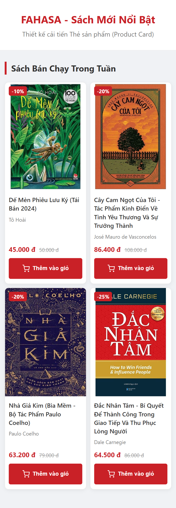

Bước 2. Củng cố cấu trúc HTML5 có ngữ nghĩa
Nội dung thực hiện

Rà soát cấu trúc HTML của khu vực danh sách sản phẩm FAHASA. Mã nguồn đã sử dụng các phần tử ngữ nghĩa như `header`, `main`, `section` và `article`, cùng hệ thống tiêu đề `h1`, `h2`, `h3` được phân cấp theo nội dung.

Sau khi kiểm tra, em bổ sung thuộc tính `aria-labelledby="section-books-title"` cho thẻ `section` và `id="section-books-title"` cho tiêu đề “Sách Bán Chạy Trong Tuần”. Hai thuộc tính này liên kết khu vực nội dung với tiêu đề tương ứng, hỗ trợ trình đọc màn hình nhận diện tên khu vực.

Giải thích các phần tử HTML

- `header`: Chứa tiêu đề và thông tin giới thiệu giao diện FAHASA.
- `main`: Xác định nội dung chính của trang.
- `section`: Phân chia khu vực danh sách sách bán chạy trong tuần.
- `article`: Đại diện cho từng sản phẩm độc lập, gồm hình ảnh, tên sách, tác giả, giá và nút thao tác.
- `h1`, `h2`, `h3`: Phân cấp tiêu đề từ tên trang, tên khu vực đến tên sản phẩm.
- `img` và `alt`: Hiển thị hình ảnh bìa sách và cung cấp nội dung thay thế khi hình ảnh không hiển thị hoặc khi sử dụng công nghệ hỗ trợ.

Kết quả

Cấu trúc HTML được giữ nguyên về bố cục và bổ sung thông tin ngữ nghĩa cho khu vực danh sách sản phẩm. Không cần thêm các thẻ `nav` hoặc `footer` khi giao diện hiện tại chưa có nội dung tương ứng. Việc chỉnh sửa không làm thay đổi cách trình bày trực quan của trang.

Bước 3. Tạo và liên kết tệp CSS
Nội dung thực hiện**

Kiểm tra tệp `styles.css` đã được xây dựng từ Buổi 1 và đường dẫn liên kết CSS trong `index.html`. Tệp CSS được đặt cùng cấp với HTML và liên kết thông qua:

`<link rel="stylesheet" href="styles.css">`

Các quy tắc CSS hiện có đã thiết lập font chữ, màu chữ, màu nền và khoảng cách cơ bản. Website sử dụng biến CSS trong `:root` để quản lý màu sắc thống nhất.

Giải thích các thuộc tính CSS

- `font-family`: Xác định kiểu chữ sử dụng trên trang.
- `background-color`: Thiết lập màu nền.
- `color`: Quy định màu chữ.
- `line-height`: Điều chỉnh khoảng cách giữa các dòng văn bản.
- `margin`: Thiết lập khoảng cách bên ngoài phần tử.
- `padding`: Thiết lập khoảng cách bên trong phần tử.

Kết quả kiểm tra

Mở trực tiếp `index.html` trên Google Chrome và xác nhận CSS đã được áp dụng. Giao diện hiển thị đúng màu sắc, kiểu chữ, bố cục bốn cột và hình ảnh sản phẩm.

Do tệp `styles.css` đã tồn tại và hoạt động đúng, em giữ nguyên cấu trúc thư mục thay vì tạo thêm một tệp CSS trùng lặp.
Minh chứng kiểm tra CSS

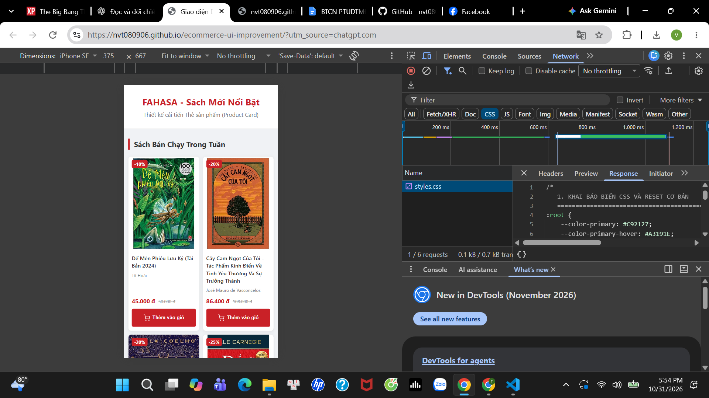

Bước 4. Thực hành CSS Selector và Box Model

Nội dung thực hiện

Tiếp tục cải thiện khu vực thẻ sản phẩm FAHASA bằng CSS Selector và Box Model. Mã nguồn sử dụng element selector (body), class selector (.product-card, .card-body, .product-title) và descendant selector (.product-title a) để định dạng các thành phần tương ứng.

Các điều chỉnh CSS gồm:
- Tăng padding của .card-body từ 12px lên 24px.
- Tăng margin-bottom của .product-title từ 6px lên 14px.
- Điều chỉnh border của .product-card từ 1px thành 2px solid #b3bdca.
- Điều chỉnh border-radius của .product-card thành 14px để tăng độ bo góc.
- Giữ nguyên cách định dạng tên sách, giá sản phẩm và nút thêm vào giỏ hàng.

Giải thích

Margin tạo khoảng cách bên ngoài phần tử, còn padding tạo khoảng cách giữa nội dung và đường viền. Thuộc tính box-sizing: border-box giúp kiểm soát kích thước phần tử khi sử dụng padding và border.

Kết quả thực hiện

Sau khi điều chỉnh CSS, giao diện thẻ sản phẩm có những thay đổi rõ ràng hơn so với phiên bản ban đầu.

Đường viền thẻ sản phẩm dày hơn, các góc được bo tròn rõ hơn. Khoảng cách giữa nội dung và đường viền tăng lên, giúp thể hiện tác động của thuộc tính padding. Khoảng cách giữa tên sách và tác giả cũng được mở rộng nhờ điều chỉnh margin-bottom.

Việc tăng padding làm không gian hiển thị nội dung thu hẹp, khiến một số tên sách xuống dòng. Tuy nhiên, bố cục bốn thẻ sản phẩm vẫn được giữ nguyên.

Các thay đổi được thực hiện trực tiếp trong styles.css, không chỉnh sửa nội dung HTML.

Minh chứng trước và sau cải thiện Box Model

Ảnh trước khi cải thiện:

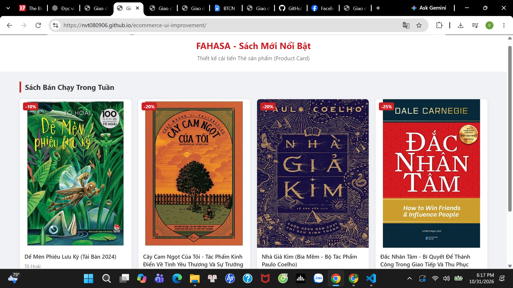

Ảnh sau khi cải thiện:

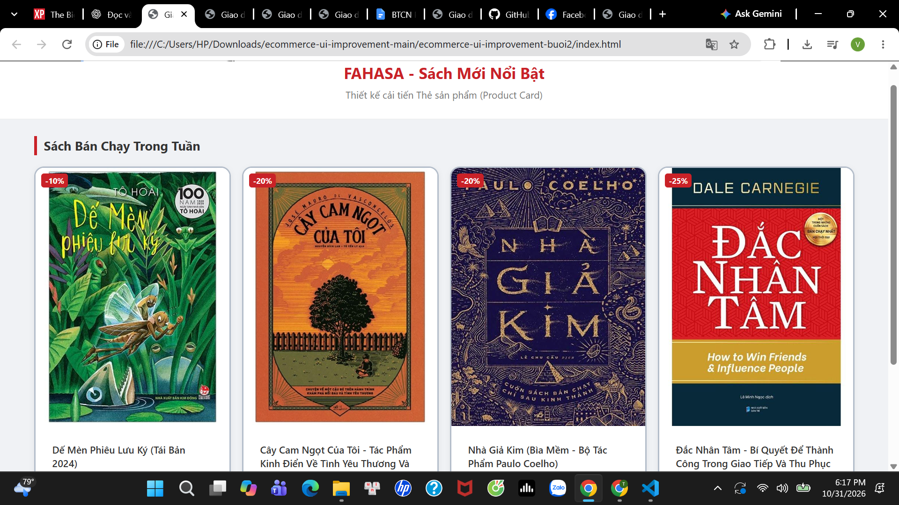

Bước 5. Thực hành Flexbox

Nội dung thực hiện

Lựa chọn nút "Thêm vào giỏ" trên thẻ sản phẩm FAHASA để thực hành Flexbox. Nút gồm hai phần tử con là biểu tượng giỏ hàng và văn bản.

Các điều chỉnh CSS gồm:

1. Thay display: inline-flex thành display: flex trong .btn-cart.
2. Giữ justify-content: center để căn giữa biểu tượng và văn bản theo chiều ngang.
3. Giữ align-items: center để căn giữa hai phần tử theo chiều dọc.
4. Tăng gap từ 6px lên 16px để tạo khoảng cách rõ hơn.

Kiểm tra và so sánh

Thử thay justify-content: center bằng space-between. Kết quả, biểu tượng giỏ hàng và văn bản được đẩy về hai phía của nút.

Sau khi so sánh, lựa chọn giữ justify-content: center vì cách căn chỉnh này giúp biểu tượng và văn bản tập trung ở giữa nút, phù hợp hơn với giao diện hiện tại.

Kết quả

Khoảng cách giữa biểu tượng và chữ tăng lên, hai thành phần vẫn được căn giữa. Kích thước các nút và bố cục bốn thẻ sản phẩm được giữ nguyên.

Minh chứng

Ảnh trước khi cải thiện:

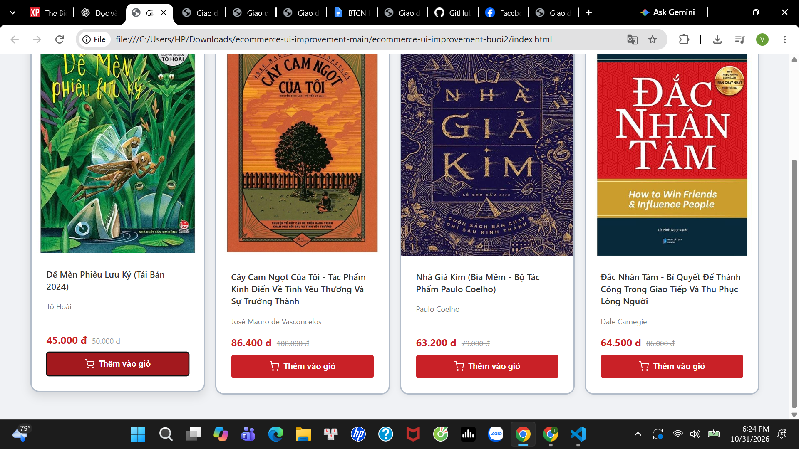

Ảnh sau khi cải thiện:

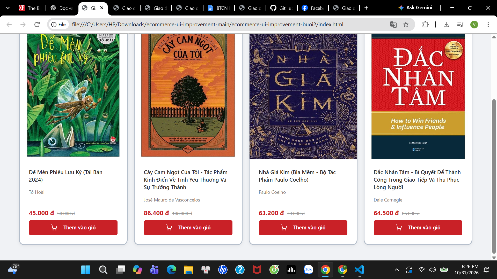

Bước 6. Hoàn thiện danh sách sản phẩm bằng CSS Grid

Nội dung thực hiện

Sử dụng CSS Grid để kiểm tra và điều chỉnh bố cục danh sách bốn sản phẩm FAHASA. Mỗi sản phẩm được đặt trong một thẻ article có class product-card, nằm bên trong phần tử cha product-grid.

Các thuộc tính CSS được sử dụng:

- display: grid thiết lập bố cục dạng lưới cho danh sách sản phẩm.
- grid-template-columns quy định số lượng và kích thước các cột.
- repeat() giúp khai báo các cột có cùng kích thước mà không cần viết lặp lại.
- gap: 16px tạo khoảng cách giữa các thẻ sản phẩm.
- object-fit: cover giúp hình ảnh giữ nguyên tỷ lệ khi phủ kín khung, nhưng có thể cắt bớt phần ảnh ở các cạnh.

Kiểm tra và so sánh

Lần 1: Thay grid-template-columns thành repeat(2, minmax(0, 1fr)). Kết quả, bốn sản phẩm được sắp xếp thành hai cột và hai hàng.

Lần 2: Thay thành repeat(3, minmax(0, 1fr)). Kết quả, ba sản phẩm nằm ở hàng đầu tiên và sản phẩm thứ tư chuyển xuống hàng tiếp theo.

Sau khi so sánh, em khôi phục repeat(4, 1fr) cho giao diện máy tính, đồng thời giữ nguyên các quy tắc responsive đã có.

Kết quả

Danh sách sản phẩm tiếp tục hiển thị theo các quy tắc responsive đã thiết lập. Trong quá trình kiểm tra, giao diện hiển thị 4 cột ở chiều rộng 1366px và 2 cột ở các chiều rộng 768px, 390px. Bố cục bốn cột được giữ lại cho giao diện máy tính vì phù hợp với danh sách bốn sản phẩm hiện tại.

Các hình ảnh giữ nguyên tỷ lệ, không xuất hiện hiện tượng kéo giãn trong quá trình kiểm tra.

Minh chứng

Ảnh thử nghiệm bố cục 2 cột:

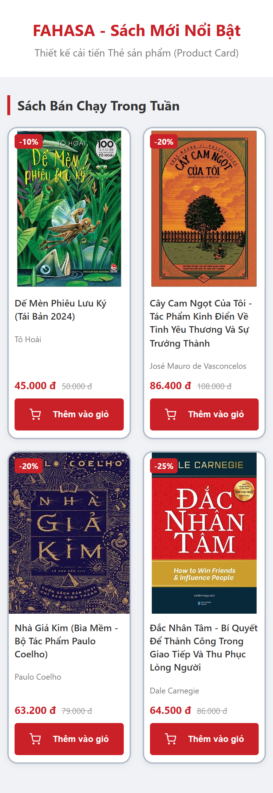

Ảnh thử nghiệm bố cục 3 cột:

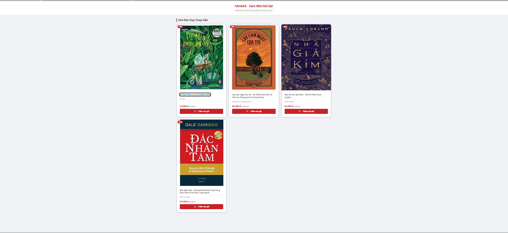

Bước 7. Bổ sung hiệu ứng Hover và Focus

Nội dung thực hiện

Lựa chọn nút "Thêm vào giỏ" trong thẻ sản phẩm FAHASA để kiểm tra và cải thiện trạng thái tương tác.

Mã CSS hiện tại đã sử dụng :hover để thay đổi màu nền của nút và transition để tạo hiệu ứng chuyển màu. Sau khi rà soát, em giữ nguyên hai thuộc tính này và bổ sung :focus-visible nhằm hỗ trợ người dùng điều hướng bằng bàn phím.

Các thuộc tính CSS được sử dụng:

- :hover: Kích hoạt hiệu ứng khi con trỏ chuột nằm trên nút.
- transition: background-color 0.2s ease: Tạo hiệu ứng chuyển đổi màu nền trong 0,2 giây.
- :focus-visible: Hiển thị dấu hiệu nhận biết khi nút nhận tiêu điểm bàn phím.
- outline: 3px solid #1d4ed8: Tạo đường viền xanh dương quanh nút.
- outline-offset: 3px: Tạo khoảng cách 3px giữa đường viền và mép nút.

Kiểm tra và kết quả

Thử nghiệm Hover: Đưa chuột lên nút "Thêm vào giỏ". Kết quả, màu nền chuyển từ đỏ sang đỏ đậm, trong khi màu chữ trắng vẫn dễ đọc.

Thử nghiệm Focus: Sử dụng phím Tab để chuyển tiêu điểm đến nút. Kết quả, đường viền xanh dương xuất hiện bên ngoài nút, giúp nhận biết phần tử đang được chọn.

Hai trạng thái được kiểm tra trên Google Chrome. Việc bổ sung focus-visible không làm thay đổi kích thước hoặc bố cục bốn thẻ sản phẩm.

Minh chứng

Ảnh trạng thái Hover:

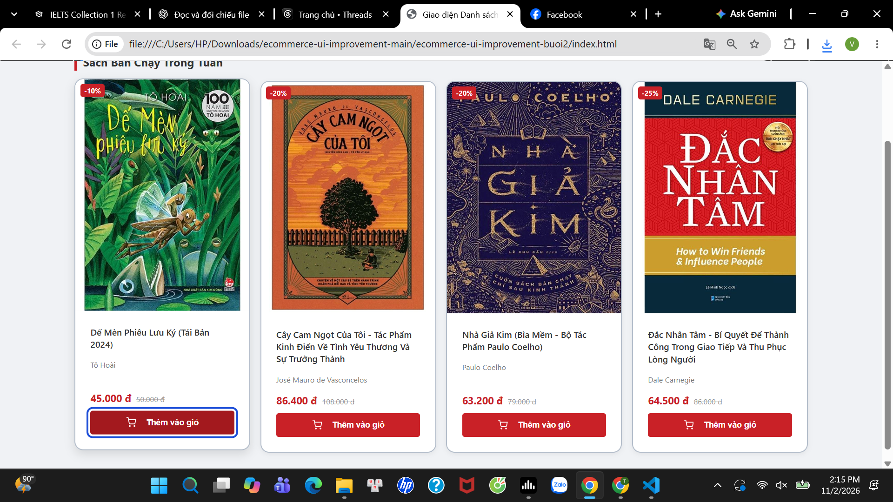

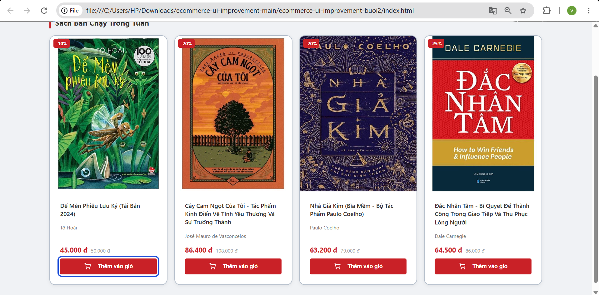

Bước 8. Kiểm tra giao diện và thực hiện thay đổi độc lập

Nội dung thực hiện

Kiểm tra giao diện FAHASA trên Google Chrome, tập trung vào hình ảnh, liên kết sản phẩm, bố cục và khả năng hiển thị trên các kích thước màn hình khác nhau.

Vấn đề phát hiện

Các liên kết ở tên sách và hình ảnh sản phẩm sử dụng href="#" nhưng không có trang chi tiết tương ứng. Khi nhấn vào tên sách, website không chuyển đến nội dung mới, dễ gây hiểu nhầm về chức năng điều hướng.

Nguyên nhân và cách khắc phục

Nguyên nhân là thẻ a chưa được gán đường dẫn đến trang đích thực tế.

Em loại bỏ các liên kết giả khỏi tên sách và hình ảnh của bốn sản phẩm. Các tiêu đề h3, nội dung sản phẩm, hình ảnh và thuộc tính alt được giữ nguyên. Không bổ sung trang mới ngoài phạm vi bài tập.

Kết quả

Sau khi chỉnh sửa, tên sách và hình ảnh không còn hoạt động như liên kết giả. Bố cục bốn thẻ sản phẩm vẫn được giữ nguyên.

Kiểm tra responsive

390px: Danh sách hiển thị 2 cột, hình ảnh, tên sách, giá và nút thao tác không bị chồng lấn.

768px: Danh sách hiển thị 2 cột, các thẻ được sắp xếp thành 2 hàng.

1366px: Danh sách hiển thị 4 cột trên một hàng.

Trong các ảnh kiểm tra, chưa phát hiện hiện tượng hình ảnh bị kéo giãn hoặc phần tử tràn khỏi thẻ sản phẩm.

Minh chứng Bước 8

Ảnh trước khi chỉnh sửa:

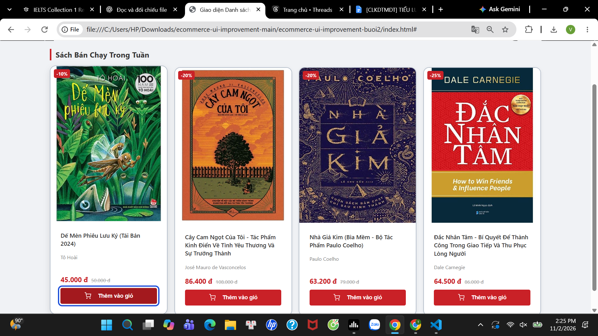

Ảnh sau khi chỉnh sửa:

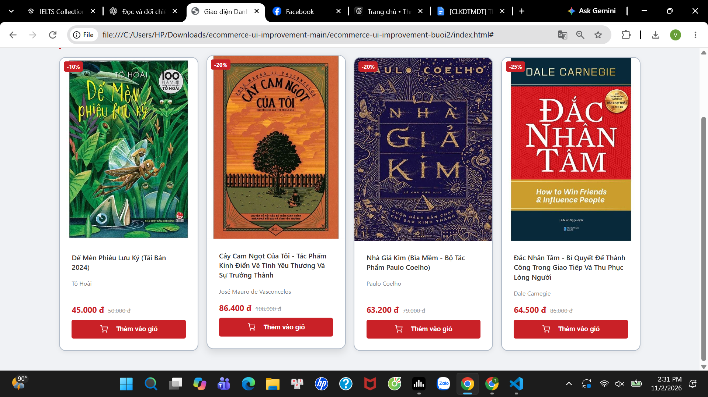

Kiểm tra giao diện ở 390px:

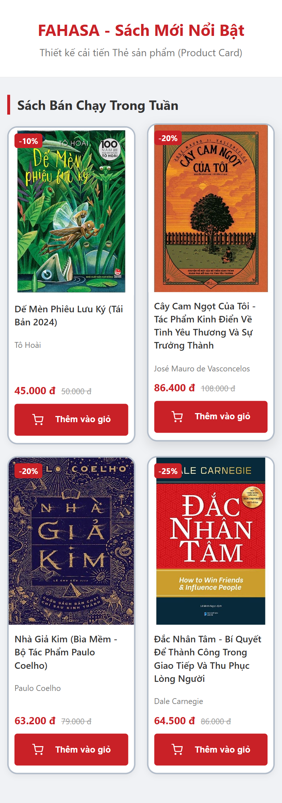

Kiểm tra giao diện ở 768px:

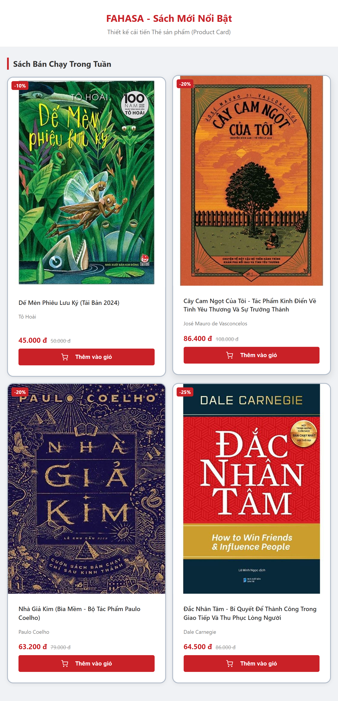

Kiểm tra giao diện ở 1366px:

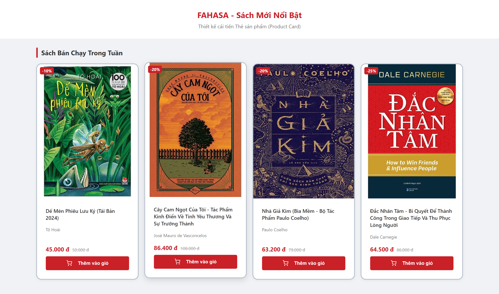

Bảng kiểm thử giao diện Bước 8

| Nội dung kiểm tra | Kết quả | Ghi chú |
|---|---|---|
| Trang HTML mở được | Đạt | Mở thành công trên Google Chrome |
| CSS được áp dụng | Đạt | Màu sắc, kiểu chữ và bố cục hiển thị đúng |
| Hình ảnh hiển thị đúng | Đạt | Cả bốn ảnh bìa đều hiển thị, không bị méo |
| Liên kết hoạt động | Giới hạn demo | Đã loại bỏ các liên kết giả href="#" do chưa có trang chi tiết |
| Bố cục không bị tràn nghiêm trọng | Đạt qua quan sát | Kiểm tra tại 390px, 768px và 1366px |
| Hover/focus hoạt động | Đạt | Đã kiểm tra bằng chuột và phím Tab |
| Đã tự sửa ít nhất một vấn đề | Đạt | Loại bỏ liên kết giả khỏi tên và ảnh sản phẩm |
